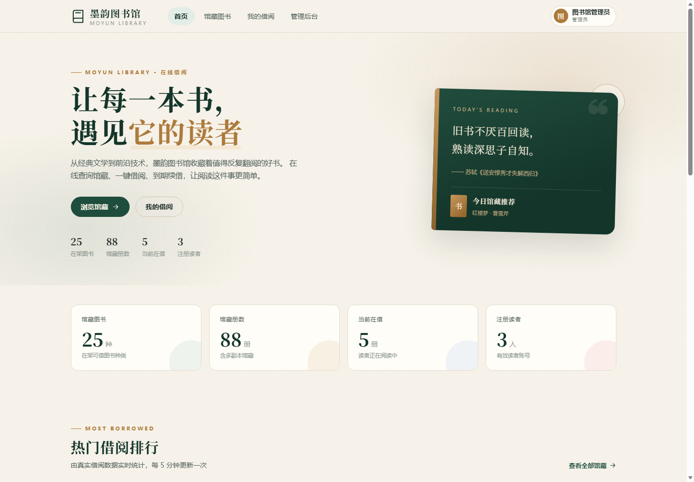
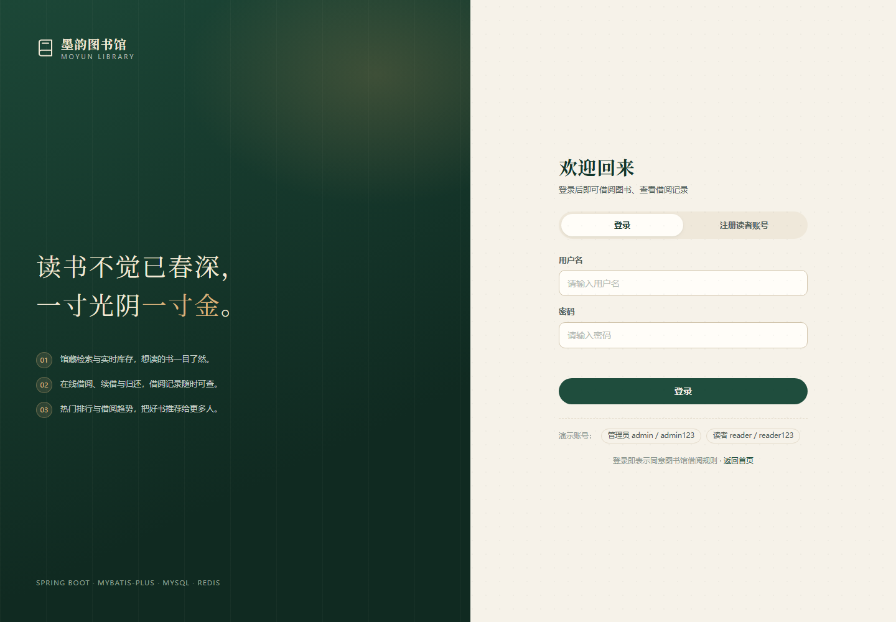
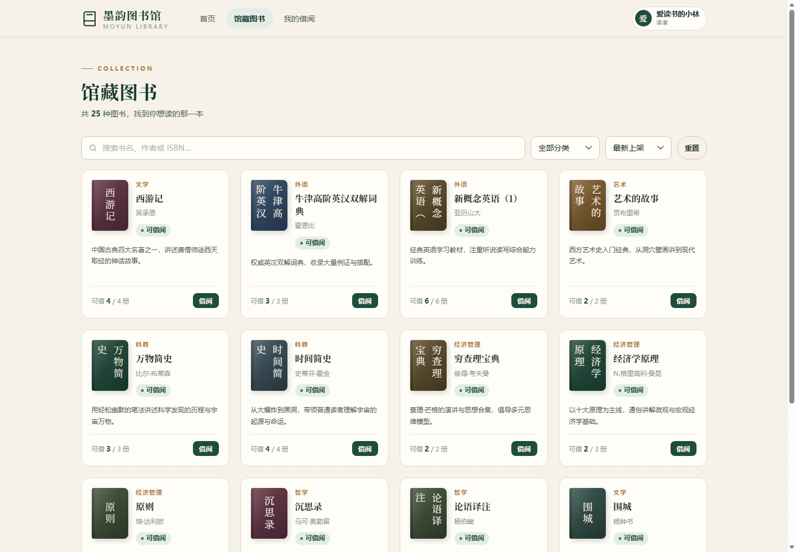
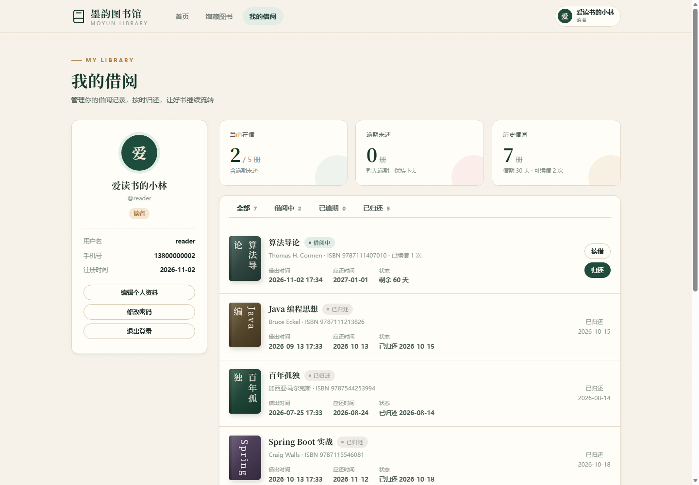
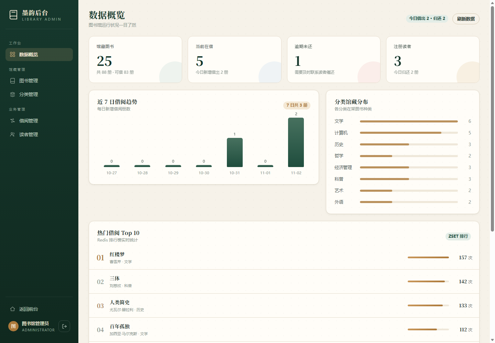
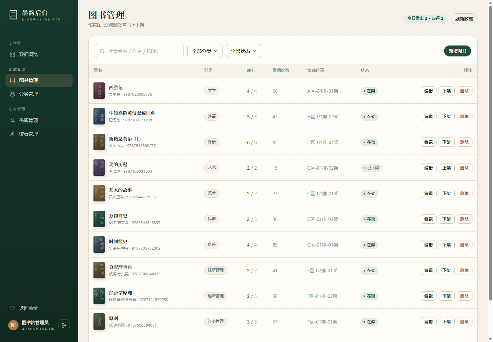
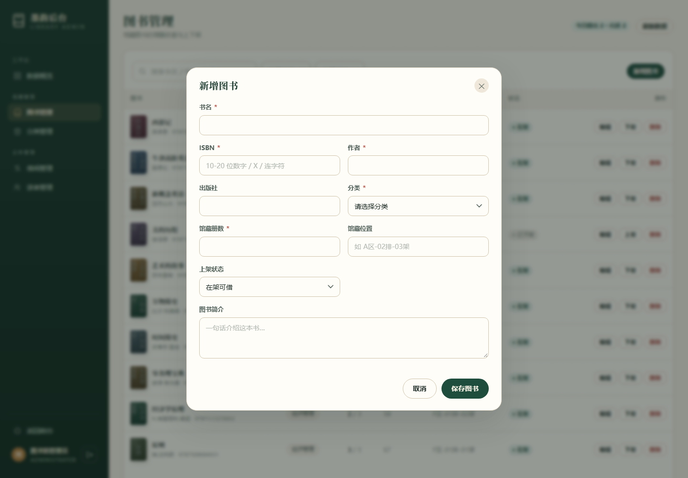

# 墨韵图书馆 · 在线图书借阅管理系统

[](https://openjdk.org/)
[](https://spring.io/projects/spring-boot)
[](https://www.mysql.com/)
[](https://redis.io/)
[](LICENSE)

一个面向「图书馆管理员 + 读者」的在线图书借阅管理系统。后端使用 **Spring Boot 3 + MyBatis-Plus + MySQL + Redis**，前端为原生 HTML / CSS / JavaScript 多页应用，由 Spring Boot 直接托管静态资源，**无需单独构建或部署前端**。

系统覆盖登录鉴权、图书与分类管理、借书 / 还书 / 续借、逾期控制、库存并发安全、热门借阅排行与运营看板。



---

## 一、项目解决什么问题

高校图书馆和院系资料室常见的问题并不是「没有书」，而是**借还过程没有系统化**：库存靠 Excel、借阅靠纸笔、逾期靠人工翻记录，读者也不知道某本书现在到底能不能借。

| 痛点 | 现状 | 本系统的做法 |
| --- | --- | --- |
| 库存对不上 | 总册数、在借数、可借数分散在表格里，归还后经常忘记加回 | 图书表维护 `total_copies` / `available_copies`，借还时用条件更新原子增减，任何时刻都能查到准确库存 |
| 借还登记易错 | 手写登记、微信群喊一声，漏记、错记难以追溯 | 每次借阅生成一条借阅记录，包含借出时间、应还时间、续借次数、归还时间与状态 |
| 逾期无人提醒 | 只能人工翻本子判断谁超期 | 以 `due_time < NOW()` 实时判断逾期；有逾期记录时禁止继续借书和续借；每小时定时同步逾期状态 |
| 读者找书难 | 不知道馆里有哪些书、放在哪一排 | 支持书名 / 作者 / ISBN 搜索、分类筛选、最新 / 最热 / 书名排序，并展示馆藏位置与可借册数 |
| 热门图书靠猜 | 采购和推荐缺乏数据依据 | Redis ZSet 按真实借阅次数累计排行，首页展示 Top 10，管理看板展示借阅趋势 |
| 权限边界模糊 | 读者也能打开管理页面、改库存 | JWT 登录态 + 角色校验：读者访问 `/api/admin/**` 一律返回 403 |
| 统计靠月底汇总 | 馆藏量、在借量、逾期量要人工统计 | 首页与管理看板实时统计，并做 30–60 秒短缓存，兼顾实时性与数据库压力 |

**明确不做（设计边界）**：在线支付 / 押金、扫码枪与自助借还硬件、短信或邮件通知、跨馆通借通还、图书预约排队、推荐算法。系统定位是「单馆借阅后台 + 读者自助查询」，把借、还、续、查这条主链路做完整。

---

## 二、主要功能

### 2.1 按角色

| 角色 | 能做什么 |
| --- | --- |
| 游客 | 浏览首页统计、热门借阅排行、新书推荐；搜索 / 分类 / 排序查看馆藏；查看图书详情；注册与登录 |
| 读者 | 借书、续借、归还；按「全部 / 借阅中 / 已逾期 / 已归还」查看自己的借阅记录与借阅概况；修改昵称、手机号；修改密码（改密后旧登录态立即失效） |
| 管理员 | 数据看板（馆藏、在借、逾期、读者、7 日趋势、分类分布、热门 Top 10）；图书新增 / 编辑 / 上下架 / 删除；分类新增 / 编辑 / 删除；查看全馆借阅记录并代办归还；读者检索、启用 / 禁用、重置密码 |

### 2.2 按模块

| 模块 | 已实现的能力 |
| --- | --- |
| 注册登录 | 读者注册（用户名 4–20 位字母 / 数字 / 下划线，密码 6–20 位，BCrypt 加密）；登录签发 JWT；Redis 保存登录态；同一账号只保留最新一次登录（单点登录）；退出、改密、被禁用、被重置密码都会让旧 token 立即失效 |
| 图书目录 | 公开分页查询；关键词（书名 / 作者 / ISBN）、分类、排序（`new` / `hot` / `title`）；图书详情；下架图书不出现在读者目录中 |
| 图书管理 | 新增、编辑、上下架、逻辑删除；ISBN 唯一校验；修改总册数时自动重算可借册数，且不能小于当前在借册数；有未归还记录时禁止删除 |
| 分类管理 | 列表带图书数量；新增、编辑、删除；名称唯一；分类下仍有图书时禁止删除 |
| 借阅业务 | 借书（校验在架、库存、逾期、并发上限、重复借阅，原子扣库存）；还书（条件更新，重复归还只生效一次）；续借（未逾期、未超最大次数、乐观条件防并发） |
| 借阅查询 | 我的借阅分页与状态筛选；借阅概况（在借、逾期、历史、上限、借期、续借规则）；管理端全馆借阅检索与代办归还 |
| 首页统计 | 在架图书种类、馆藏总册数、可借册数、当前在借、注册读者、今日借出；热门 Top 10；最新上架 8 本 |
| 管理看板 | 馆藏 / 在借 / 逾期 / 读者四项指标；近 7 日借阅趋势；分类馆藏分布；热门借阅 Top 10 |
| 读者管理 | 关键词 / 角色 / 状态筛选；启用与禁用（禁用立即踢下线）；重置密码（重置后旧密码与旧登录态立即失效）；展示每位读者的在借与逾期数量 |
| 安全与治理 | 统一返回结构；全局异常处理；参数校验；401 未登录 / 403 无权限 / 409 业务冲突；逻辑删除；接口权限注解 |

### 2.3 借阅规则

| 规则 | 默认值 | 行为 |
| --- | --- | --- |
| 借阅期限 | 30 天 | `due_time = borrow_time + 30 天` |
| 续借时长 | 30 天 / 次 | 每次续借在原应还时间上再加 30 天 |
| 最大续借次数 | 2 次 | 超过后返回 400「最多续借 2 次」 |
| 同时借阅上限 | 5 册 | 达到上限后返回 400，提示先归还部分图书 |
| 逾期判断 | 实时 | `due_time < NOW()` 即为逾期，不依赖状态字段 |
| 逾期限制 | 强制 | 有逾期未还记录时禁止借书；逾期记录禁止续借，但可以归还 |
| 重复借阅 | 禁止 | 同一读者对同一本书只能有一条未归还记录（数据库唯一索引兜底） |
| 库存扣减 | 原子 | `available_copies > 0` 才允许扣减，避免并发超借 |

以上参数可在 `application.yml` 的 `library.borrow.*` 中调整，无需改代码。

### 2.4 权限与会话

- 公开接口：`/api/auth/login`、`/api/auth/register`、`/api/books/**`、`/api/categories`、`/api/home`。
- 其余 `/api/**` 需要请求头 `Authorization: Bearer <token>`。
- 管理端控制器标注 `@RequireRole("ADMIN")`，拦截器先校验登录态，再校验角色。
- 未携带 token 或 token 已失效返回 `401`；已登录但角色不足返回 `403`。
- JWT 只承载身份信息（userId、username、role、jti），真正的登录态保存在 Redis，因此可以随时「踢下线」。

### 2.5 技术栈

| 层次 | 技术 |
| --- | --- |
| 语言 / 运行时 | Java 21（`release=21`；已在 JDK 25 上完成构建与运行验证） |
| 框架 | Spring Boot 3.5.16、Spring MVC、Jakarta Validation |
| 持久层 | MyBatis-Plus 3.5.7（分页插件、条件构造器、逻辑删除） |
| 数据库 | MySQL 8.0（utf8mb4、外键、CHECK、生成列 + 唯一索引） |
| 缓存 / 排行 | Redis（Spring Data Redis / Lettuce），使用 database 1 |
| 鉴权 | JJWT 0.12.6（HS384）、BCrypt |
| 构建 | Maven 3.9 |
| 前端 | 原生 HTML / CSS / JavaScript，无前端构建步骤 |

---

## 三、安装方法

### 3.1 环境要求

| 组件 | 版本 | 说明 |
| --- | --- | --- |
| JDK | 21 及以上 | 项目以 `release=21` 编译；已在 JDK 25 上验证 |
| Maven | 3.8 及以上 | 构建与依赖管理 |
| MySQL | 8.0 及以上 | 库名 `library_db`；需要具备建库权限（首次启动自动建库） |
| Redis | 5.0 及以上 | 默认 `127.0.0.1:6379`、`db 1`、无密码 |

### 3.2 获取代码

```bash
git clone https://github.com/ewefa/moyun-library.git
cd moyun-library
```

如果使用本仓库的本地目录，直接进入项目根目录即可。

### 3.3 启动 MySQL 与 Redis

```bash
# Redis 是否可用
redis-cli ping          # 期望输出 PONG

# MySQL 是否可用（按实际账号修改）
mysql -uroot -p -e "SELECT VERSION();"
```

数据库与表结构**不需要手工创建**：

- JDBC URL 带 `createDatabaseIfNotExist=true`，首次启动会自动创建 `library_db`；
- `spring.sql.init.mode=always` 会在每次启动时执行 `db/schema.sql` 与 `db/data.sql`；
- 脚本使用 `CREATE TABLE IF NOT EXISTS` 与 `INSERT IGNORE`，可重复执行，不会重复插入演示数据。

如果希望手工初始化，也可以：

```bash
mysql -uroot -p -e "CREATE DATABASE IF NOT EXISTS library_db DEFAULT CHARACTER SET utf8mb4 COLLATE utf8mb4_unicode_ci;"
mysql -uroot -p library_db < src/main/resources/db/schema.sql
mysql -uroot -p library_db < src/main/resources/db/data.sql
```

### 3.4 配置

默认配置在 `src/main/resources/application.yml`，本地演示可直接使用：

| 配置项 | 默认值 | 说明 |
| --- | --- | --- |
| `server.port` | `8080` | 服务端口 |
| `spring.datasource.url` | `jdbc:mysql://127.0.0.1:3306/library_db...` | 自动建库 |
| `spring.datasource.username` / `password` | `root` / `123456` | 可用环境变量覆盖 |
| `spring.data.redis.database` | `1` | 使用 1 号库，避免与其他项目冲突 |
| `spring.sql.init.mode` | `always` | 每次启动执行幂等初始化脚本 |
| `library.jwt.secret` | 演示密钥 | HS384 签名密钥，**生产必须替换** |
| `library.jwt.expire-hours` | `24` | 登录态有效期（小时） |
| `library.borrow.loan-days` | `30` | 借阅期限（天） |
| `library.borrow.renew-days` | `30` | 每次续借延长天数 |
| `library.borrow.max-renew` | `2` | 最大续借次数 |
| `library.borrow.max-borrowing` | `5` | 单读者同时借阅上限 |

推荐通过环境变量覆盖敏感配置，不要把真实口令写进仓库：

```powershell
# Windows PowerShell
$env:DB_USERNAME="root"
$env:DB_PASSWORD="你的数据库密码"
$env:LIBRARY_JWT_SECRET="至少32字节的随机字符串"
```

```bash
# Linux / macOS
export DB_USERNAME=root
export DB_PASSWORD='你的数据库密码'
export LIBRARY_JWT_SECRET='至少32字节的随机字符串'
```

### 3.5 构建与启动

```bash
# 方式一：Maven 直接运行
mvn spring-boot:run

# 方式二：打包后运行
mvn -DskipTests package
java -jar target/library-system-0.1.0.jar
```

Windows 下如果控制台中文乱码，可显式指定编码（**引号不能省**，否则 Java 会把参数当成类名）：

```powershell
java '-Dfile.encoding=UTF-8' -jar target\library-system-0.1.0.jar
```

也可以直接使用项目根目录的启动脚本：

- Windows：双击 `start.bat`
- Linux / macOS：`./start.sh`

启动成功后访问：<http://localhost:8080/>

控制台出现 `Started LibraryApplication in ... seconds` 即表示启动完成；首次启动还会自动建表并写入演示数据。

> 如果 8080 被占用，可改 `server.port`，或先停止占用端口的进程。

### 3.6 演示账号

| 角色 | 用户名 | 密码 | 说明 |
| --- | --- | --- | --- |
| 管理员 | `admin` | `admin123` | 登录后进入管理后台 |
| 读者 | `reader` | `reader123` | 含借阅中、已归还记录 |
| 读者 | `zhangwei` | `reader123` | 含一条逾期记录，用于演示逾期控制 |
| 读者 | `lina` | `reader123` | 普通借阅记录 |

> 演示账号与默认 JWT 密钥仅用于本地体验。正式部署请立即修改密码、通过环境变量注入数据库口令与 JWT 密钥。

---

## 四、使用方法

### 4.1 页面入口

| 页面 | 地址 | 是否需要登录 |
| --- | --- | --- |
| 首页 | <http://localhost:8080/> | 否 |
| 登录 / 注册 | <http://localhost:8080/login.html> | 否 |
| 馆藏图书 | <http://localhost:8080/books.html> | 否（借书需要登录） |
| 我的借阅 | <http://localhost:8080/my.html> | 是 |
| 管理后台 | <http://localhost:8080/admin.html> | 是，且必须是管理员 |

首页、图书列表、图书详情是公开的；点击「借阅」时如果未登录，会跳转到登录页，并在登录后回到原来的图书。

### 4.2 游客

1. 打开首页，查看馆藏统计、热门借阅 Top 10 与最新上架。
2. 进入「馆藏图书」，输入书名 / 作者 / ISBN，或选择分类、排序方式。
3. 点击图书卡片查看详情：出版社、ISBN、馆藏位置、总册数与可借册数。
4. 点击「借阅」→ 未登录会跳转登录页；也可以先注册一个读者账号。

### 4.3 注册与登录

- 登录页支持「登录 / 注册」两个标签。
- 注册字段：用户名、密码、确认密码、昵称、手机号（可选）。注册成功后自动登录。
- 登录成功后：读者跳转首页，管理员跳转管理后台。
- 右上角用户菜单可以进入「我的借阅」或退出登录。
- 同一账号在新设备登录后，旧设备的 token 立即失效（再操作会返回 401 并跳转登录页）。

### 4.4 借书

1. 在馆藏页找到想借的书，确认「可借 N / 总 M 册」大于 0。
2. 点击「借阅」。系统依次校验：账号正常 → 图书存在且上架 → 有可借副本 → 没有逾期记录 → 未超过 5 册上限 → 没有重复借阅。
3. 校验通过后扣减库存并生成借阅记录，应还时间为 30 天后。
4. 如果失败，页面会直接提示原因，例如：
   - 「您有逾期未还的图书，请先归还后再借阅」
   - 「您已借阅该书且尚未归还」
   - 「该书暂无可借副本」

### 4.5 续借与归还

进入「我的借阅」：

- **续借**：借阅中的记录可以续借，每次延长 30 天，最多 2 次；已逾期记录不能续借。
- **归还**：点击「归还」并确认，库存立即加回，状态变为「已归还」。
- 页面会显示「剩余 N 天」；逾期记录显示「逾期 N 天」，并给出明显标识。

管理员也可以在「借阅管理」中直接为读者办理归还。

### 4.6 我的借阅

- 顶部三张卡片：当前在借（含逾期）、逾期未还、历史借阅。
- 标签页：全部 / 借阅中 / 已逾期 / 已归还，数量实时统计。
- 「借阅中」只包含未到期记录；「已逾期」包含已到期但定时任务尚未同步状态的记录。
- 左侧可以修改昵称 / 手机号，或修改密码。改密成功后旧登录态立即失效，需要重新登录。

### 4.7 管理员后台

左侧菜单对应五个面板：

| 面板 | 可以做什么 |
| --- | --- |
| 数据概览 | 查看馆藏、在借、逾期、读者数；近 7 日借阅趋势；分类馆藏分布；热门 Top 10 |
| 图书管理 | 搜索 / 分类 / 状态筛选；新增、编辑、上架、下架、删除；查看库存与借阅次数 |
| 分类管理 | 新增、编辑、删除分类；查看每个分类下的图书数量 |
| 借阅管理 | 按读者 / 书名 / ISBN 搜索；按借阅中 / 已逾期 / 已归还筛选；代办归还 |
| 读者管理 | 搜索读者；启用 / 禁用账号；重置密码；查看在借与逾期数量 |

新增图书时需要注意：

- ISBN 必须唯一，格式为 10–20 位数字、`X` 或连字符；
- 馆藏册数 1–999；
- 修改总册数时不能小于当前在借册数；
- 图书有未归还记录时不能删除，只能下架。

### 4.8 五分钟演示路线

1. 用 `reader / reader123` 登录，进入馆藏页借一本有库存的书。
2. 打开「我的借阅」，看到新记录，点一次「续借」，观察应还时间与剩余天数变化。
3. 点「归还」，再回馆藏页确认可借册数已恢复。
4. 用 `zhangwei / reader123` 登录，打开「我的借阅」→「已逾期」，尝试续借，观察 400 提示。
5. 用 `admin / admin123` 登录，打开管理后台：看板 → 图书管理 → 新增 / 上下架 → 借阅管理代办归还 → 读者管理禁用账号。
6. 被禁用的读者再次登录，会收到「账号已被禁用，请联系图书馆管理员」。

### 4.9 局域网访问

如果希望同一局域网内的其他设备访问，确保防火墙放行 8080 端口，然后使用本机内网 IP：

```text
http://<本机内网IP>:8080/
```

---

## 五、输入输出示例

### 5.1 统一约定

所有接口都返回 HTTP 200，业务状态放在 `code` 字段：

```json
{
  "code": 200,
  "message": "操作成功",
  "data": {}
}
```

| `code` | 含义 | 典型场景 |
| --- | --- | --- |
| `200` | 成功 | 查询、借还、增删改成功 |
| `400` | 参数或业务校验失败 | 库存不足、达到借阅上限、已逾期 |
| `401` | 未登录或登录失效 | 未带 token、token 过期、被踢下线 |
| `403` | 无权限 | 读者访问管理端接口、账号被禁用 |
| `404` | 资源不存在 | 图书 / 借阅记录不存在 |
| `409` | 业务冲突 | 重复借阅、ISBN 已存在、分类下仍有图书 |
| `500` | 服务器异常 | 未预期异常（会记录日志，不返回堆栈） |

- 登录后接口统一使用 `Authorization: Bearer <token>`。
- 分页返回 `{ records, total, page, size, pages }`。
- 时间格式为 `yyyy-MM-dd HH:mm:ss`，时区 `Asia/Shanghai`。

> 下面的 JSON 来自本地演示环境的一次真实调用。图书库存、借阅数量、记录 ID 会随演示操作变化，字段结构保持不变。

### 5.2 界面上的输入 → 输出

| 你在界面上的操作 | 实际请求 | 页面看到的结果 |
| --- | --- | --- |
| 输入 `reader / reader123` 登录 | `POST /api/auth/login` | 跳转首页，右上角显示昵称 |
| 搜索「三体」 | `GET /api/books?keyword=三体` | 只展示匹配的图书卡片 |
| 选择分类「计算机」+ 按最热排序 | `GET /api/books?categoryId=2&sort=hot` | 计算机类图书按借阅次数降序 |
| 点击「借阅」 | `POST /api/borrows`，body `{"bookId":2}` | 提示「借阅成功」，可借册数 -1，我的借阅多一条记录 |
| 点击「续借」 | `PUT /api/borrows/11/renew` | 应还时间 +30 天，剩余天数增加 |
| 点击「归还」 | `PUT /api/borrows/11/return` | 记录变为「已归还」，库存 +1 |
| 管理员新增图书 | `POST /api/admin/books` | 表格出现新书，首页「最新上架」可见 |
| 管理员下架图书 | `PUT /api/admin/books/23/status` | 状态变为「已下架」，读者目录不再展示 |
| 管理员禁用读者 | `PUT /api/admin/users/3/status` | 该读者立即无法登录，旧 token 失效 |

### 5.3 登录

```bash
curl -s -X POST http://localhost:8080/api/auth/login \
  -H "Content-Type: application/json" \
  -d '{"username":"reader","password":"reader123"}'
```

```json
{
  "code": 200,
  "message": "登录成功",
  "data": {
    "token": "eyJhbGciOiJIUzM4NCJ9.eyJqdGkiOi...",
    "expiresIn": 86400,
    "user": {
      "id": 2,
      "username": "reader",
      "nickname": "爱读书的小林",
      "role": "READER",
      "phone": "13800000002",
      "status": 1,
      "createTime": "2026-11-02 17:33:55"
    }
  }
}
```

- `expiresIn` 单位为秒，默认 86400（24 小时）。
- 登录响应中的 `user` 不包含在借 / 逾期数量；这两个数字由 `GET /api/borrows/summary` 提供。
- 后续请求携带：`Authorization: Bearer <token>`。

### 5.4 查询图书列表

```bash
curl -s "http://localhost:8080/api/books?page=1&size=3&sort=hot"
```

```json
{
  "code": 200,
  "message": "操作成功",
  "data": {
    "records": [
      {
        "id": 1,
        "isbn": "9787020002207",
        "title": "红楼梦",
        "author": "曹雪芹",
        "publisher": "人民文学出版社",
        "categoryId": 1,
        "categoryName": "文学",
        "totalCopies": 5,
        "availableCopies": 5,
        "location": "A区-01排-01架",
        "status": 1,
        "description": "中国古典四大名著之一，以贾、史、王、薛四大家族的兴衰为背景。",
        "borrowCount": 157,
        "createTime": "2026-11-02 17:33:55"
      },
      {
        "id": 2,
        "isbn": "9787536692930",
        "title": "三体",
        "author": "刘慈欣",
        "publisher": "重庆出版社",
        "categoryId": 6,
        "categoryName": "科普",
        "totalCopies": 6,
        "availableCopies": 5,
        "location": "C区-02排-03架",
        "status": 1,
        "description": "地球文明与三体文明的信息交流、生死搏杀及两个文明在宇宙中的兴衰历程。",
        "borrowCount": 142,
        "createTime": "2026-11-02 17:33:55"
      }
    ],
    "total": 25,
    "page": 1,
    "size": 3,
    "pages": 9
  }
}
```

参数说明：

| 参数 | 默认值 | 说明 |
| --- | --- | --- |
| `page` | `1` | 页码，从 1 开始 |
| `size` | `12` | 每页数量，最大 100 |
| `keyword` | 空 | 匹配书名、作者或 ISBN |
| `categoryId` | 空 | 分类 ID |
| `sort` | `new` | `new` 最新 / `hot` 最热 / `title` 书名 |

### 5.5 借书

```bash
curl -s -X POST http://localhost:8080/api/borrows \
  -H "Content-Type: application/json" \
  -H "Authorization: Bearer <token>" \
  -d '{"bookId":1}'
```

```json
{
  "code": 200,
  "message": "借阅成功",
  "data": {
    "id": 11,
    "userId": 2,
    "username": "reader",
    "nickname": "爱读书的小林",
    "bookId": 1,
    "bookTitle": "红楼梦",
    "bookAuthor": "曹雪芹",
    "isbn": "9787020002207",
    "borrowTime": "2026-11-03 12:10:40",
    "dueTime": "2026-12-03 12:10:40",
    "returnTime": null,
    "renewCount": 0,
    "status": 0,
    "daysLeft": 30,
    "overdueDays": 0
  }
}
```

- `status`：`0` 借阅中、`1` 已归还、`2` 已逾期。
- `daysLeft` 与 `overdueDays` 由后端按日期计算，前端直接展示。
- 并发下如果库存被抢完，会返回 409「手慢了，该书已被借完」。

### 5.6 续借与归还

续借：

```bash
curl -s -X PUT http://localhost:8080/api/borrows/11/renew \
  -H "Authorization: Bearer <token>"
```

```json
{
  "code": 200,
  "message": "续借成功",
  "data": {
    "id": 11,
    "bookTitle": "红楼梦",
    "borrowTime": "2026-11-03 12:10:40",
    "dueTime": "2027-01-02 12:10:40",
    "renewCount": 1,
    "status": 0,
    "daysLeft": 60,
    "overdueDays": 0
  }
}
```

归还：

```bash
curl -s -X PUT http://localhost:8080/api/borrows/11/return \
  -H "Authorization: Bearer <token>"
```

```json
{
  "code": 200,
  "message": "归还成功",
  "data": null
}
```

归还成功后：借阅记录状态变为 `1`、写入 `returnTime`、对应图书 `available_copies + 1`。重复归还返回 409「该记录已归还，请勿重复操作」。

### 5.7 借阅概况与我的借阅

```bash
curl -s http://localhost:8080/api/borrows/summary \
  -H "Authorization: Bearer <token>"
```

```json
{
  "code": 200,
  "message": "操作成功",
  "data": {
    "borrowingCount": 1,
    "overdueCount": 0,
    "historyCount": 7,
    "maxBorrowing": 5,
    "loanDays": 30,
    "renewDays": 30,
    "maxRenew": 2
  }
}
```

`GET /api/borrows/my?status=0&page=1&size=10` 返回分页记录，结构与 5.5 的 `data` 相同；`status` 省略表示全部。

### 5.8 管理端统计

```bash
curl -s http://localhost:8080/api/admin/stats \
  -H "Authorization: Bearer <admin-token>"
```

```json
{
  "code": 200,
  "message": "操作成功",
  "data": {
    "totalBooks": 25,
    "totalCopies": 88,
    "availableCopies": 84,
    "borrowingCount": 4,
    "readerCount": 3,
    "overdueCount": 1,
    "todayBorrows": 0,
    "todayReturns": 1,
    "trend": [
      { "date": "10-28", "count": 0 },
      { "date": "10-29", "count": 0 },
      { "date": "10-30", "count": 0 },
      { "date": "10-31", "count": 1 },
      { "date": "11-01", "count": 0 },
      { "date": "11-02", "count": 2 },
      { "date": "11-03", "count": 0 }
    ],
    "categoryStats": [
      { "name": "文学", "count": 6 },
      { "name": "计算机", "count": 5 }
    ],
    "hotBooks": [
      { "bookId": 1, "title": "红楼梦", "author": "曹雪芹", "categoryName": "文学", "availableCopies": 5, "borrowCount": 157 }
    ]
  }
}
```

说明：`trend` 固定返回最近 7 天（含今天），`categoryStats` 与 `hotBooks` 为完整数组，示例中做了截断。

### 5.9 典型错误响应

未登录：

```json
{ "code": 401, "message": "请先登录", "data": null }
```

token 已失效（被新登录挤掉、改密、禁用或重置密码）：

```json
{ "code": 401, "message": "登录状态已失效，请重新登录", "data": null }
```

读者访问管理端接口：

```json
{ "code": 403, "message": "没有权限执行该操作", "data": null }
```

有逾期记录时借书：

```json
{ "code": 400, "message": "您有逾期未还的图书，请先归还后再借阅", "data": null }
```

重复借阅同一本书：

```json
{ "code": 409, "message": "您已借阅该书且尚未归还", "data": null }
```

其他常见提示：

| 场景 | `code` | `message` |
| --- | --- | --- |
| 图书已下架 | `400` | 该图书已下架，暂不可借阅 |
| 库存不足 | `409` | 该书暂无可借副本 / 手慢了，该书已被借完 |
| 达到借阅上限 | `400` | 最多同时借阅 5 册，请先归还部分图书 |
| 逾期后续借 | `400` | 图书已逾期，无法续借，请先归还 |
| 超过续借次数 | `400` | 最多续借 2 次 |
| ISBN 重复 | `409` | ISBN 已存在 |
| 删除有未还记录的图书 | `409` | 该书还有 N 册未归还，无法删除 |
| 删除仍有图书的分类 | `409` | 该分类下还有 N 种图书，请先移动或删除图书 |
| 账号被禁用后登录 | `403` | 账号已被禁用，请联系图书馆管理员 |
| 参数校验失败 | `400` | 例如：书名最多 80 个字符 |

---

## 六、项目结构

```text
library-system
├─ src/main/java/com/library
│  ├─ LibraryApplication.java        # 启动类（Mapper 扫描、配置属性、定时任务）
│  ├─ common/                        # Result、PageResult、BizException、全局异常、Redis 工具、上下文
│  ├─ config/                        # MyBatis-Plus 分页、Jackson、拦截器注册、library 配置属性
│  ├─ security/                      # JwtUtil、AuthInterceptor、@RequireRole、UserContext
│  ├─ controller/                    # Auth / Book / Category / Borrow / Home / Admin
│  ├─ service/                       # 认证、图书、分类、借阅、统计、排行、读者
│  ├─ mapper/                        # MyBatis-Plus Mapper
│  ├─ entity/ dto/ vo/               # 实体、请求参数、返回视图
│  └─ task/                          # 逾期状态同步任务
├─ src/main/resources
│  ├─ application.yml
│  ├─ db/schema.sql                  # 建表脚本（幂等）
│  ├─ db/data.sql                    # 演示数据（幂等）
│  ├─ mapper/BookMapper.xml          # 图书复杂查询
│  ├─ mapper/BorrowRecordMapper.xml  # 借阅列表、趋势、分类统计
│  └─ static/                        # 前端页面、样式、脚本
│     ├─ index.html  login.html  books.html  my.html  admin.html
│     ├─ css/style.css
│     └─ js/common.js home.js login.js books.js my.js admin.js
├─ docs/screenshots/                 # 界面截图
├─ LICENSE                           # MIT
├─ README.md
├─ start.bat / start.sh              # 启动脚本
└─ pom.xml
```

---

## 七、数据库设计

库名 `library_db`，字符集 `utf8mb4`，共 4 张表。

### 7.1 `t_user` 用户表

| 字段 | 类型 | 说明 |
| --- | --- | --- |
| `id` | BIGINT | 主键，自增 |
| `username` | VARCHAR(32) | 登录名，唯一索引 `uk_user_username` |
| `password` | VARCHAR(100) | BCrypt 密文，不返回给前端 |
| `nickname` | VARCHAR(32) | 昵称 |
| `role` | VARCHAR(16) | `ADMIN` / `READER` |
| `phone` | VARCHAR(20) | 手机号 |
| `status` | TINYINT | `1` 正常、`0` 禁用 |
| `create_time` / `update_time` | DATETIME | 创建 / 更新时间 |
| `deleted` | TINYINT | 逻辑删除：`0` 正常、`1` 删除 |

### 7.2 `t_category` 分类表

`name`（名称）、`sort`（越小越靠前）、`description`、逻辑删除。删除前校验分类下是否还有图书。

### 7.3 `t_book` 图书表

| 字段 | 类型 | 说明 |
| --- | --- | --- |
| `isbn` | VARCHAR(20) | ISBN，索引 `idx_book_isbn` |
| `title` / `author` / `publisher` | VARCHAR | 图书基本信息 |
| `category_id` | BIGINT | 分类外键 |
| `total_copies` | INT | 馆藏总册数 |
| `available_copies` | INT | 可借册数 |
| `location` | VARCHAR(40) | 馆藏位置，如 `A区-01排-01架` |
| `status` | TINYINT | `1` 上架、`0` 下架 |
| `borrow_count` | INT | 累计借阅次数，用于排行重建 |
| `deleted` | TINYINT | 逻辑删除 |

约束：`CHECK (available_copies >= 0 AND available_copies <= total_copies)`；`category_id` 外键指向 `t_category`；`status` 与 `category_id` 建索引。

### 7.4 `t_borrow_record` 借阅记录表

| 字段 | 类型 | 说明 |
| --- | --- | --- |
| `user_id` / `book_id` | BIGINT | 读者、图书外键 |
| `borrow_time` | DATETIME | 借出时间 |
| `due_time` | DATETIME | 应还时间 |
| `return_time` | DATETIME | 实际归还时间，未归还为 `NULL` |
| `renew_count` | INT | 已续借次数 |
| `status` | TINYINT | `0` 借阅中、`1` 已归还、`2` 已逾期 |
| `active_flag` | TINYINT | 生成列：`status IN (0,2)` 时为 `1`，否则为 `NULL` |

关键索引：

```sql
UNIQUE KEY uk_borrow_user_book_active (user_id, book_id, active_flag)
```

同一读者对同一本书只允许一条「未归还」记录；归还后 `active_flag` 变为 `NULL`，可以再次借阅。这个唯一索引是并发重复借阅的最后一道防线。

### 7.5 演示数据

- 4 个账号：`admin`、`reader`、`zhangwei`、`lina`
- 8 个分类：文学、计算机、历史、哲学、经济管理、科普、艺术、外语
- 26 本图书（其中 1 本下架，25 本在架）
- 10 条借阅记录，覆盖借阅中、已逾期、已归还三种状态

---

## 八、Redis 使用说明

| Key | 类型 | TTL | 用途 |
| --- | --- | --- | --- |
| `library:token:token:{token}` | String(JSON) | 24h | token → 登录用户（userId、username、nickname、role） |
| `library:token:user:{userId}` | String | 24h | 用户 → 当前有效 token，用于单点登录与踢下线 |
| `library:rank:borrow` | ZSet | 永久 | 热门借阅排行，member=图书 ID，score=借阅次数 |
| `library:cache:hot:top` | String(JSON) | 5min | 热门 Top 列表缓存 |
| `library:cache:home:stats` | String(JSON) | 60s | 首页统计 + 热门 + 新书 |
| `library:cache:admin:stats` | String(JSON) | 30s | 管理看板 |
| `library:cache:categories` | String(JSON) | 10min | 分类列表 |

设计要点：

- 登录态以 Redis 为准，JWT 只负责传递身份；删除 Redis key 即可让 token 立即失效。
- 写操作（借书、还书、图书 / 分类变更、用户状态变更）会主动删除相关缓存，避免脏数据。
- 热门排行先读缓存，再读 ZSet；ZSet 为空时按数据库 `borrow_count` 重建；Redis 异常时降级查库，不影响借还主流程。
- Redis 使用 `database 1`，避免与同一台机器上的其他演示项目冲突。

---

## 九、完整接口清单

### 9.1 认证

| 方法 | 路径 | 权限 | 说明 |
| --- | --- | --- | --- |
| POST | `/api/auth/register` | 公开 | 注册读者并自动登录 |
| POST | `/api/auth/login` | 公开 | 登录，返回 token 与用户信息 |
| POST | `/api/auth/logout` | 登录 | 退出登录，删除当前 token |
| GET | `/api/auth/me` | 登录 | 当前登录用户 |
| PUT | `/api/auth/profile` | 登录 | 修改昵称、手机号 |
| PUT | `/api/auth/password` | 登录 | 修改密码，旧 token 立即失效 |

### 9.2 图书、分类与首页（公开）

| 方法 | 路径 | 说明 |
| --- | --- | --- |
| GET | `/api/books?page=&size=&keyword=&categoryId=&sort=` | 在架图书分页 |
| GET | `/api/books/{id}` | 图书详情 |
| GET | `/api/books/hot?limit=10` | 热门图书，`limit` 1–20 |
| GET | `/api/categories` | 分类列表（带图书数量） |
| GET | `/api/home` | 首页统计 + 热门 Top 10 + 最新 8 本 |

### 9.3 借阅（需登录）

| 方法 | 路径 | 说明 |
| --- | --- | --- |
| POST | `/api/borrows` | 借书，body `{"bookId":1}` |
| PUT | `/api/borrows/{id}/return` | 归还 |
| PUT | `/api/borrows/{id}/renew` | 续借 |
| GET | `/api/borrows/my?status=&page=&size=` | 我的借阅，`status` 可省略 |
| GET | `/api/borrows/summary` | 借阅概况 |

### 9.4 管理端（需 `ADMIN`）

| 方法 | 路径 | 说明 |
| --- | --- | --- |
| GET | `/api/admin/books?page=&size=&keyword=&categoryId=&status=` | 图书分页（含下架） |
| POST | `/api/admin/books` | 新增图书 |
| PUT | `/api/admin/books/{id}` | 编辑图书 |
| DELETE | `/api/admin/books/{id}` | 删除图书 |
| PUT | `/api/admin/books/{id}/status` | 上架 / 下架，body `{"status":1}` |
| GET | `/api/admin/categories` | 分类列表 |
| POST | `/api/admin/categories` | 新增分类 |
| PUT | `/api/admin/categories/{id}` | 编辑分类 |
| DELETE | `/api/admin/categories/{id}` | 删除分类 |
| GET | `/api/admin/borrows?page=&size=&keyword=&status=` | 全馆借阅记录 |
| PUT | `/api/admin/borrows/{id}/return` | 代办归还 |
| GET | `/api/admin/users?page=&size=&keyword=&role=&status=` | 读者列表 |
| PUT | `/api/admin/users/{id}/status` | 启用 / 禁用 |
| PUT | `/api/admin/users/{id}/reset-password` | 重置密码 |
| GET | `/api/admin/stats` | 管理看板数据 |

---

## 十、关键设计说明

### 10.1 登录与会话

1. 登录校验 BCrypt 密码与账号状态，签发带 `jti` 的 JWT（HS384，24 小时）。
2. 将 `LoginUser` JSON 写入 `library:token:token:{token}`，同时把 token 写入 `library:token:user:{userId}`。
3. 如果该用户已有旧 token，先删除旧 token 的两个 Key，实现「新登录挤掉旧登录」。
4. 拦截器解析 Bearer token → 校验 JWT → 查 Redis 登录态 → 写入 `UserContext`。
5. 退出、改密、被禁用、被重置密码都会删除对应 token，旧请求立即 401。

使用 `jti`（随机 UUID）而不是只用时间戳，是为了保证同一秒内的两次登录也能得到不同 token；否则「第二次登录挤掉第一次」无法被观察到。

### 10.2 并发安全的库存

借书时执行条件更新：

```sql
UPDATE t_book
SET available_copies = available_copies - 1,
    borrow_count = borrow_count + 1
WHERE id = ? AND available_copies > 0 AND deleted = 0
```

影响行数为 0 说明库存已被其他请求抢完，直接返回 409，不会出现负库存。

归还时先条件更新借阅记录：

```sql
UPDATE t_borrow_record
SET status = 1, return_time = ?
WHERE id = ? AND status IN (0, 2)
```

只有第一次归还会成功，避免并发重复归还导致库存加两次。

### 10.3 重复借阅防护

借阅表使用生成列 + 唯一索引：

```sql
active_flag TINYINT GENERATED ALWAYS AS (IF(status IN (0,2), 1, NULL)) STORED,
UNIQUE KEY uk_borrow_user_book_active (user_id, book_id, active_flag)
```

应用层先查一次给出友好提示，数据库唯一索引兜底，防止并发请求绕过检查。

### 10.4 逾期判断

- 业务判断统一使用 `due_time < NOW()`，而不是只依赖 `status = 2`。
- 定时任务每小时把已到期记录同步为 `2`，应用启动时也执行一次。
- 列表中「借阅中」只显示未到期记录；「已逾期」包含已到期但状态尚未同步的记录。
- `daysLeft` / `overdueDays` 由后端按日期计算，避免前端时区误差。

### 10.5 热门排行

- 借阅成功后 `ZINCRBY library:rank:borrow 1 {bookId}`。
- 读取 Top N 时先取缓存，再取 ZSet 前 N 名，回表补图书与分类信息。
- ZSet 为空时按数据库 `borrow_count` 重建；Redis 异常时直接降级查库。

### 10.6 缓存策略

| 数据 | TTL | 失效方式 |
| --- | --- | --- |
| 首页统计 | 60s | 到期 + 借还 / 图书 / 分类变更时主动删除 |
| 管理看板 | 30s | 到期 + 借还 / 图书 / 分类 / 用户变更时主动删除 |
| 分类列表 | 10min | 到期 + 分类增删改时主动删除 |
| 热门 Top | 5min | 到期 + 借阅成功后主动删除 |

### 10.7 统一返回与异常

- 所有接口返回 HTTP 200，业务状态放在 `code`。
- `BizException` 携带业务码与提示语，由 `GlobalExceptionHandler` 统一转换为 `Result`。
- 参数校验异常取第一条字段错误返回 400。
- 未预期异常记录日志并返回 500，不向前端暴露堆栈。

### 10.8 安全说明

- 密码使用 BCrypt 加盐哈希，数据库中不保存明文。
- JWT 密钥、数据库口令支持环境变量注入；仓库中只保留演示默认值。
- 管理端接口统一角色校验，读者无法通过直接调用接口越权。
- 逻辑删除保留历史数据，借阅记录不随图书删除而丢失。

---

## 十一、定时任务

| 任务 | 频率 | 作用 |
| --- | --- | --- |
| 逾期状态同步 | 每小时整点（`0 0 * * * ?`） | 把 `due_time < NOW()` 且状态为借阅中的记录改为已逾期，并清除看板缓存 |
| 启动时同步 | 应用启动完成后执行一次 | 避免停机期间产生的逾期记录状态滞后 |

业务判断本身不依赖这个任务：即使状态还没同步，借书、续借、列表展示仍会按 `due_time` 实时判断。

---

## 十二、界面预览

| 首页 | 登录 / 注册 |
| --- | --- |
|  |  |

| 馆藏图书 | 我的借阅 |
| --- | --- |
|  |  |

| 管理看板 | 图书管理 |
| --- | --- |
|  |  |

新增图书弹窗：



---

## 十三、常见问题

**1. 启动时报数据库连接失败？**

确认 MySQL 已启动、端口与账号密码正确。项目会自动创建 `library_db`，但数据库账号需要有建库权限。也可以在 `application.yml` 中把 `createDatabaseIfNotExist=true` 去掉，改为手动建库。

**2. Redis 连不上会影响使用吗？**

登录态依赖 Redis：Redis 不可用时登录与鉴权会失败。统计与排行读接口做了降级，但核心登录流程需要 Redis 正常。请确认 `redis-cli ping` 返回 `PONG`，且使用的 database 1 没有被其他程序清空。

**3. 启动时报 8080 端口被占用？**

修改 `server.port`，或停止占用端口的进程：

```powershell
# Windows：查看占用 8080 的进程
netstat -ano | findstr :8080
```

**4. 控制台中文乱码？**

Windows 下使用：

```powershell
java '-Dfile.encoding=UTF-8' -jar target\library-system-0.1.0.jar
```

引号必须保留，否则 Java 会把 `-Dfile.encoding=UTF-8` 当成类名。

**5. Maven 构建时报 `JAVA_HOME` 异常？**

确认 `JAVA_HOME` 指向 JDK 21+ 的安装目录，且路径中不要包含不可见字符。可以临时指定：

```powershell
$env:JAVA_HOME="C:\path\to\jdk-21"
mvn -DskipTests package
```

**6. 页面打开还是旧样式？**

项目已关闭静态资源缓存（`spring.web.resources.cache.period=0`）。如果仍看到旧资源，强制刷新浏览器，或确认启动的是最新打包的 jar。

**7. 如何清空演示数据重新开始？**

删除数据库 `library_db` 后重启应用，会自动重新建表并写入演示数据：

```sql
DROP DATABASE library_db;
```

也可以手动重新执行 `db/schema.sql` 与 `db/data.sql`。

**8. 为什么读者借不了书？**

按顺序检查：账号是否被禁用 → 图书是否上架 → 是否还有可借副本 → 是否有逾期未还 → 是否已达 5 册上限 → 是否已借过同一本书未还。接口会返回具体原因。

---

## 十四、许可证

本项目基于 [MIT License](LICENSE) 开源，可自由用于学习、修改与商业项目。

```text
MIT License

Copyright (c) 2026 ewefa
```

如果这个项目对你有帮助，欢迎点个 Star ⭐
